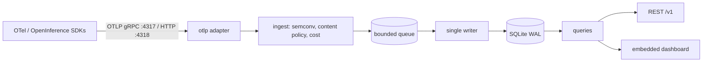

# Loupe

Production LLM observability in one binary: send OpenTelemetry traces, see every
LLM call, tool call and agent step with tokens, cost and latency. For small and
medium teams that want to self-host LLM observability next to their app.

**Status:** v0.1.0, the first release. Before 1.0, a minor release may change the
REST API, the configuration and the CLI; every change is listed in the
[changelog](CHANGELOG.md) with a migration note. Loupe follows Semantic Versioning: a
patch release only fixes bugs, and only the latest minor release receives fixes.

[](https://github.com/thnhdatle/loupe/actions/workflows/ci.yml)
[](https://goreportcard.com/report/github.com/thnhdatle/loupe)
[](https://github.com/thnhdatle/loupe/releases)
[](LICENSE)

## Why it exists

LLM applications are non-deterministic, so failures and cost spikes are found in
production traces, not in tests. Self-hosting Langfuse v3 requires Postgres,
ClickHouse, Redis and S3-compatible object storage, and proxy-based tools use
their own schema instead of OpenTelemetry. Small and medium teams want something
they can run next to their app with one command, that speaks OpenTelemetry, and
whose capacity is stated as measured numbers. Loupe is one binary and one SQLite
file, with retention and a disk cap.

## Quickstart

Needs Docker with Compose v2, [uv](https://docs.astral.sh/uv/) and Go. From a clone of the repository:

```sh
git clone https://github.com/thnhdatle/loupe && cd loupe
```

```bash
export RAYLD_LOUPE_IMAGE="${RAYLD_LOUPE_IMAGE:-ghcr.io/thnhdatle/loupe:v0.1.0}"
export RAYLD_FAKELLM_IMAGE="${RAYLD_FAKELLM_IMAGE:-ghcr.io/thnhdatle/fakellm:v0.1.0}"
docker compose -f deploy/docker-compose.yml up -d --wait
docker compose -f deploy/docker-compose.yml logs loupe | grep 'dashboard login'
LOUPE_API_TOKEN="$(docker cp "$(docker compose -f deploy/docker-compose.yml ps -q loupe)":/data/api_token - | tar -xO)" ./examples/python-openai/run.sh
```

This starts Loupe (data in the `loupe-data` volume; dashboard `:3000`, OTLP gRPC
`:4317`, OTLP HTTP `:4318`, all on host loopback) and a fake OpenAI-compatible
provider, runs an instrumented example app against it and prints the trace Loupe
stored. Open the logged `dashboard login` URL once to sign in to the dashboard.
Point your own app at Loupe with `OTEL_EXPORTER_OTLP_ENDPOINT=http://127.0.0.1:4318`
and `OTEL_EXPORTER_OTLP_PROTOCOL=http/protobuf`; see
[docs/guides/quickstart.md](docs/guides/quickstart.md). Stop with
`docker compose -f deploy/docker-compose.yml down -v`.

## Install

Pick one of:

```sh
go install github.com/thnhdatle/loupe/cmd/loupe@v0.1.0
docker pull ghcr.io/thnhdatle/loupe:v0.1.0
```

or download a `loupe_0.1.0_<os>_<arch>.tar.gz` archive for Linux or macOS (amd64,
arm64) from the [releases page](https://github.com/thnhdatle/loupe/releases) and
check it against `checksums.txt`:

```sh
sha256sum --ignore-missing -c checksums.txt   # macOS: shasum -a 256 --ignore-missing -c checksums.txt
```

Then run `loupe serve` (defaults listen on `127.0.0.1` only) or see
[operations](docs/guides/operations.md) for the container image, Docker Compose
and Kubernetes.

## Architecture



OTLP receivers decode traces and GenAI log events into domain types, which are
translated by semantic-convention rules, passed through the content policy and
priced. A bounded queue feeds exactly one writer goroutine that commits batches
to SQLite in WAL mode; slots are released only on commit. Readers use a separate
read-only pool behind the REST API and the server-rendered dashboard embedded in
the binary.

## Features

- OTLP ingest over gRPC and HTTP: traces and GenAI log events, with optional bearer tokens and TLS ([instrumentation](docs/guides/instrumentation.md), [operations](docs/guides/operations.md))
- Semantic normalisation of `gen_ai`, OpenInference and legacy conventions ([instrumentation](docs/guides/instrumentation.md))
- Cost and token accounting with an editable price table and recompute ([pricing](docs/guides/pricing.md))
- Rollups and percentiles by model, user and time ([operations](docs/guides/operations.md))
- REST query and export API with an OpenAPI spec, and an embedded dashboard ([quickstart](docs/guides/quickstart.md), [errors](docs/guides/errors.md))
- Content capture off by default, redaction presets and per-user deletion ([privacy](docs/guides/privacy.md))
- Retention by age and a hard disk cap ([retention](docs/guides/retention.md))
- Backup, upgrade with automatic pre-migration copy, Prometheus metrics and health endpoints ([operations](docs/guides/operations.md))
- Problems and fixes: [troubleshooting](docs/guides/troubleshooting.md)

## Benchmarks

Loupe v0.1.0 pre-release build, measured on 2026-10-19 on a MacBook Pro M3 Pro
(11 cores, 36 GB, macOS 26.1, arm64) with the native `loupe serve` binary and
default config. These are the figures of [bench/RESULTS.md](bench/RESULTS.md),
which has the full tables, the payload, the command and the raw data.

| Metric | Value |
|---|---|
| Sustained ingest at a constant 3,000 spans/s (3 x 10 min; target >= 3,000) | 3,001 spans/s sent, 0 lost, peak RSS 213 MiB |
| Single-writer capacity | 15,000 spans/s (clean at 15,000, rejects at 20,000) |
| Overload at 45,000 spans/s | ~15,100 spans/s accepted, rest rejected or dropped, 0 unaccounted, peak RSS 470 MiB |
| Query p95 at 2M spans / 30 days (target < 1 s) | 0.058 s (worst of 8 queries) |
| Bytes per million spans | ~531 MB (content captured) to ~957 MB (heavier attributes, no content) |
| Start to ready / idle RSS / image (targets < 1 s / < 100 MiB / < 50 MB) | 0.85 s max (0.02 s median, first start of a new binary) / 29.8 MiB / 23.3 MB |

## Configuration

One YAML file plus `LOUPE_<PATH>` environment overrides; see
[docs/guides/configuration.md](docs/guides/configuration.md) for every option. The
most used:

| Option | Default | Env var |
|---|---|---|
| `storage.path` | `./loupe.db` | `LOUPE_STORAGE_PATH` |
| `receiver.http.listen` | `127.0.0.1:4318` | `LOUPE_RECEIVER_HTTP_LISTEN` |
| `content.capture` | `off` | `LOUPE_CONTENT_CAPTURE` |
| `retention.spans` | `14d` | `LOUPE_RETENTION_SPANS` |
| `retention.max_db_bytes` | `10GiB` | `LOUPE_RETENTION_MAX_DB_BYTES` |

## Known limitations

- One node and one SQLite file with a single writer: the measured capacity is
  15,000 spans/s; there is no multi-node or high-availability mode.
- OTLP metrics are accepted and discarded; logs other than GenAI events are not
  stored.
- `self_tracing.endpoint` is validated but ignored: Loupe does not export its own
  traces.
- The admin listener (`/metrics`, `/readyz`, pprof) has no authentication; keep it
  on a trusted network.
- The container image accepts unauthenticated OTLP on `0.0.0.0`; publish its ports
  on loopback or set receiver tokens ([operations](docs/guides/operations.md)).
- `loupe version` prints `dev` for a binary built with `go install`; release
  archives and images carry the version.
- Unix only (Linux, macOS); no downgrade of a migrated database (restore the
  automatic `.pre-v<N>` copy instead).

## Comparison / when not to use it

- Loupe has no evals, experiments, prompt management or playground in v0.1.
- Storage is a single SQLite file on one node; there is no multi-node mode.
- OTLP metrics are accepted and discarded; only traces and GenAI log events are
  stored.
- Choose Loupe when you want one binary and OpenTelemetry; choose another tool if
  you need the features above.

## Roadmap

See [ROADMAP.md](ROADMAP.md).

## Contributing

See [CONTRIBUTING.md](CONTRIBUTING.md). Licensed under the
[Apache License 2.0](LICENSE).
