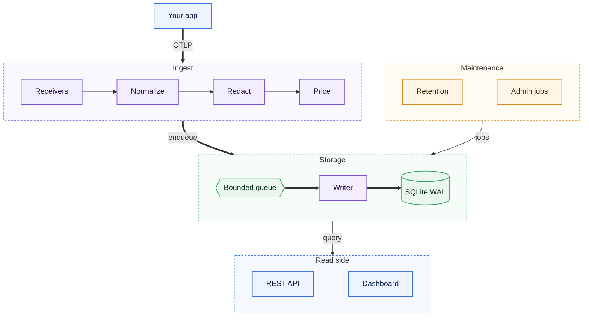

# Loupe

Self-hosted LLM observability in one binary: send OpenTelemetry traces, see every LLM call with tokens, cost and latency.

[](https://github.com/thnhdatle/loupe/actions/workflows/ci.yml)
[](https://github.com/thnhdatle/loupe/releases)
[](LICENSE)

## Architecture



Receivers decode OTLP traces, normalise them, apply the content policy and add cost. One writer
commits batches to a single SQLite file, while the REST API and dashboard read it.

## Why

LLM failures and cost spikes show up in production traces, not in tests. Many self-hosted tools
need several databases and services, or use their own schema instead of OpenTelemetry. Loupe is
one binary and one SQLite file, with retention and a disk cap.

## Install

```sh
go install github.com/thnhdatle/loupe/cmd/loupe@v0.1.1    # binary
docker pull ghcr.io/thnhdatle/loupe:v0.1.1                # container image
```

Prebuilt binaries for Linux and macOS are on the [releases page](https://github.com/thnhdatle/loupe/releases).

## Quickstart

Needs Docker with Compose v2, [uv](https://docs.astral.sh/uv/) and Go. From a clone of the repository:

```sh
git clone https://github.com/thnhdatle/loupe && cd loupe
```

```bash
export RAYLD_LOUPE_IMAGE="${RAYLD_LOUPE_IMAGE:-ghcr.io/thnhdatle/loupe:v0.1.1}"
export RAYLD_FAKELLM_IMAGE="${RAYLD_FAKELLM_IMAGE:-ghcr.io/thnhdatle/fakellm:v0.1.1}"
docker compose -f deploy/docker-compose.yml up -d --wait
docker compose -f deploy/docker-compose.yml logs loupe | grep 'dashboard login'
LOUPE_API_TOKEN="$(docker cp "$(docker compose -f deploy/docker-compose.yml ps -q loupe)":/data/api_token - | tar -xO)" ./examples/python-openai/run.sh
```

It prints the trace Loupe stored. Open the logged login URL to sign in to the dashboard.

## Usage

```sh
# Point any OpenTelemetry SDK at Loupe.
export OTEL_EXPORTER_OTLP_ENDPOINT=http://127.0.0.1:4318
export OTEL_EXPORTER_OTLP_PROTOCOL=http/protobuf

# List the most expensive traces of the last 24 hours.
curl -H "Authorization: Bearer $LOUPE_API_TOKEN" \
  'http://127.0.0.1:3000/v1/traces?sort=cost&limit=5'
```

To explain a failing or slow trace, point Analyze at any OpenAI-compatible model and press
Analyze on the trace page, or call `POST /v1/traces/{trace_id}/analyze`. It is off until set:

```sh
LOUPE_ANALYZE_BASE_URL=http://127.0.0.1:1234/v1 LOUPE_ANALYZE_MODEL=qwen/qwen3-vl-4b loupe serve
```

SDK setup, pricing, privacy, retention and operations are covered in the [guides](docs/guides).
What Analyze sends to the model is in [privacy](docs/guides/privacy.md#analyze).

## Performance

MacBook Pro M3 Pro 36 GB, Loupe v0.1.0, native binary, default config, fresh database per run.
Load is OTLP/HTTP protobuf at a constant arrival rate.

| Scenario | Result |
|---|---|
| Sustained ingest, 3 x 10 min | 3,001 spans/s, 0 lost, peak RSS 213 MiB |
| Single-writer capacity | 15,000 spans/s |
| Query p95 at 2M spans / 30 days | 0.058 s (worst of 8 queries) |

## Documentation

- [Guides](docs/guides)
- [REST API reference](api/openapi.yaml)
- [Roadmap](ROADMAP.md)
- [Changelog](CHANGELOG.md)
- [Contributing](CONTRIBUTING.md)
- [Security](SECURITY.md)
- [License: Apache-2.0](LICENSE)
